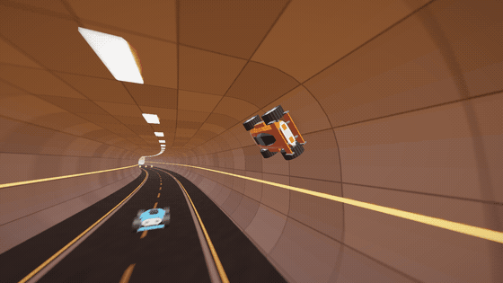
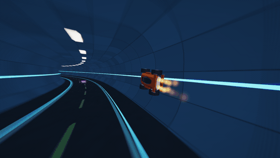
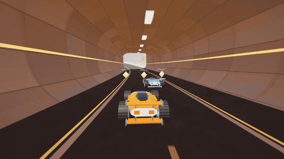
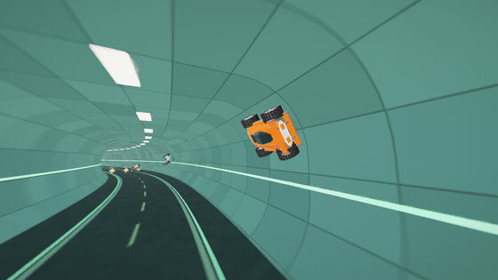
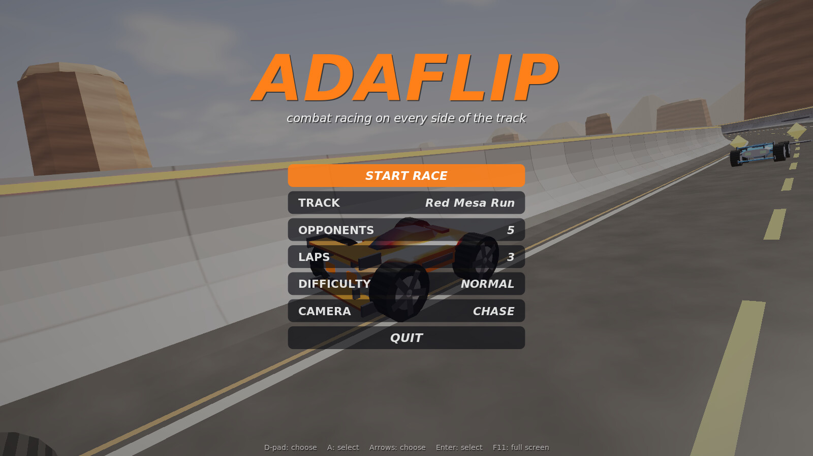
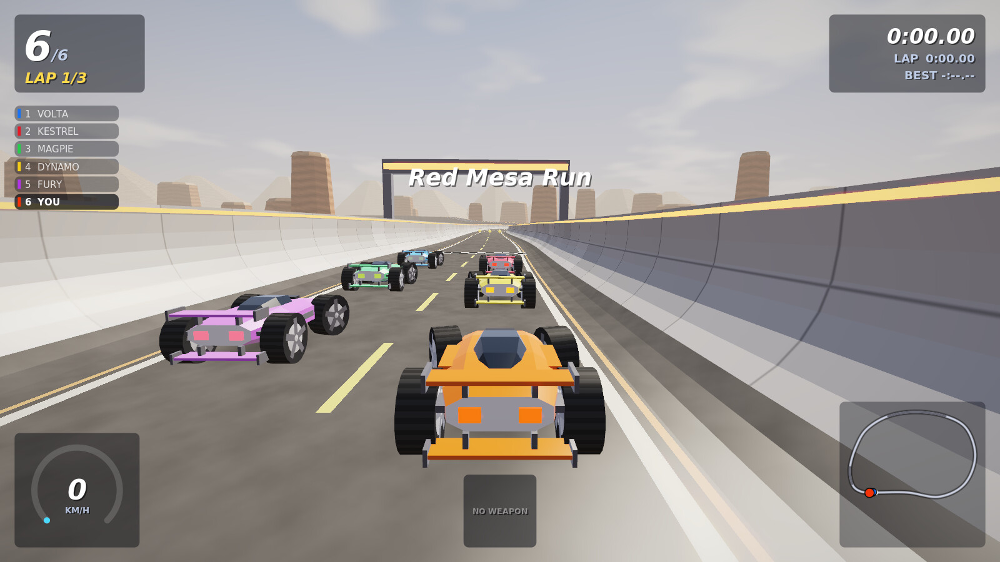
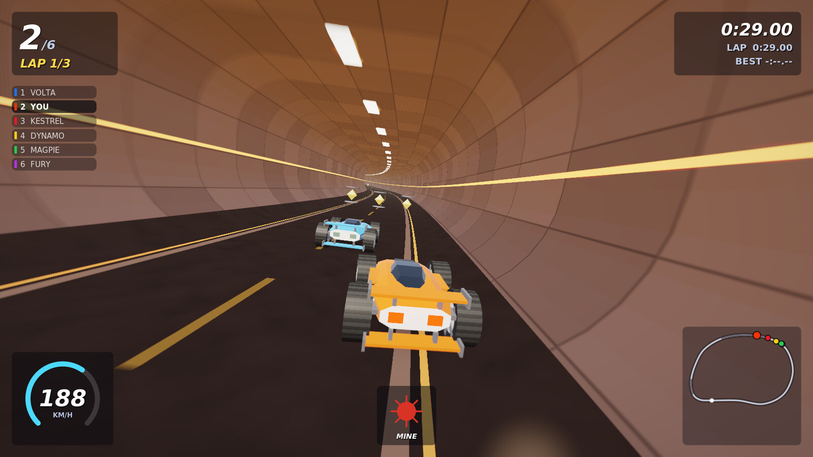
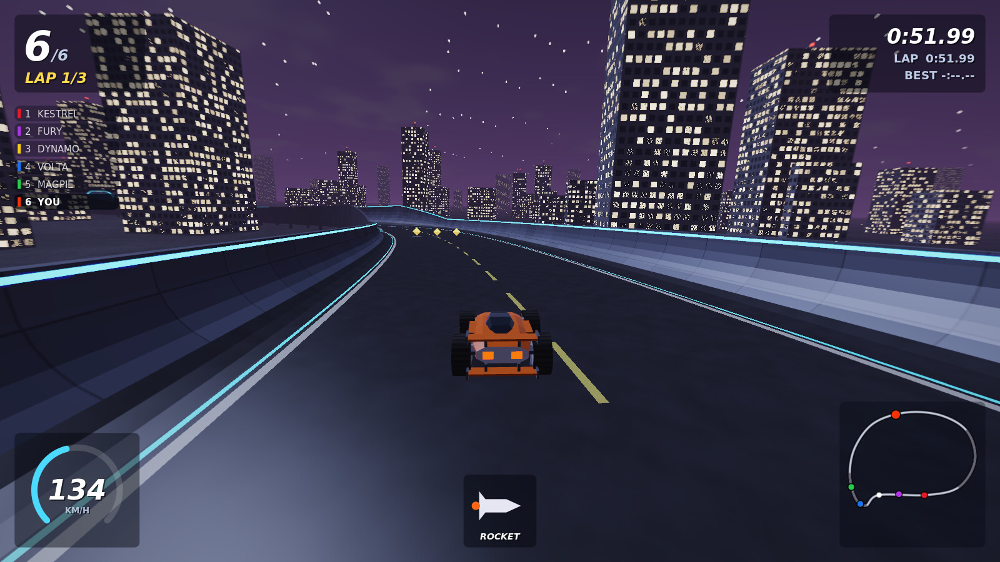
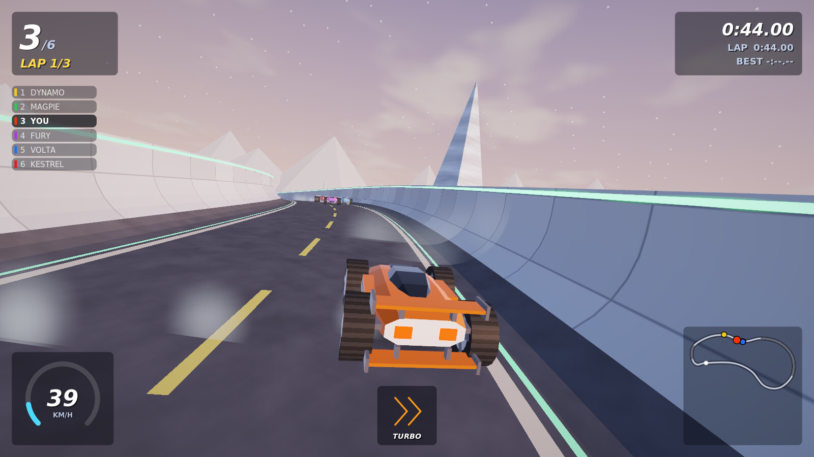

# AdaFlip

A combat racer in Ada and GtkAda. Its cars drive on whichever side they land on. They ride up
walls and along tunnel roofs at speed, and fight with rockets, mines and shockwaves picked up
from pods along the track. Play it with a game controller (an Xbox pad) or the keyboard.

> **Early development.** It is playable from start to finish, but expect rough edges and
> changes to handling, tracks and weapons.

| | |
|---|---|
|  |  |
| Through the pipe of Harbour Lights, on its roof | Thrown up the wall by a mine, and on again |
|  |  |
| Along Frostline's tunnel roof | The title screen, over a race of AI cars |
|  |  |
| On the grid at Red Mesa Run | Into a tunnel, a mine in hand |
|  |  |
| Harbour Lights at night | Frostline at dusk |

All of it is the game itself with the AI at the wheel, made by `scripts/make_media.sh`.

> **Built with AI.** Written by [Claude](https://www.anthropic.com/claude) Opus 5.5 in Claude
> Code from the author's prompts. The OpenGL, GtkGLArea, shader, mesh and gamepad layers come
> from the author's earlier project AdaRace.

## Getting started

    make run

That needs GNAT, gprbuild, GtkAda, libepoxy and PulseAudio. `make` checks for them first and
says what is missing and how to install it (`make check` does only that). On Debian, Ubuntu
and Mint:

    sudo apt install gnat gprbuild libgtkada-dev libgtk-3-dev libepoxy-dev libpulse-dev pkg-config

The game needs OpenGL 4.5. An Xbox controller is found by itself, and one plugged in later is
found within a few seconds. When several pads are plugged in, an Xbox pad is preferred.

## Controls

| | Controller | Keyboard |
|---|---|---|
| Steer | left stick | ← → or A D |
| Throttle | right trigger | ↑ or W |
| Brake, reverse | left trigger | ↓ or S |
| Fire the weapon | A or RB | Space or Ctrl |
| Look back | B or LB (held) | B (held) |
| Look round | right stick | |
| Camera | Y or Back | C |
| Back on the track | X | R |
| Pause | Start | Esc or P |
| Full screen | | F11 |
| Frame rate | | F3 |

In the menus: d-pad or left stick to choose and change, A to select, B to go back.

## The game

- **Every side is a road.** The wheels stand out above the body as far as below it, so a car
  that rolls over drives on upside down. Steering always turns the way you push the stick.
- **Walls and roofs.** Above about 40 km/h the car clings to walls, pipe walls and tunnel roofs.
  Slow down there and it falls off. Halfpipes have tall curved sides to ride up, and pipes are
  round all the way.
- **Weapons**, one at a time, from the gold pods three abreast on the track:
  - *Turbo*: three seconds of extra thrust.
  - *Rocket*: homes on the nearest car ahead.
  - *Mine*: dropped behind you.
  - *Shockwave*: throws every car within 28 m.
  - *Shield*: six seconds in which nothing can touch you.
- **Three tracks**:
  - *Red Mesa Run* (2.5 km, desert, day): halfpipes, a tunnel, a jump over a crest and a pipe.
  - *Harbour Lights* (2.2 km, a city at night): tunnels, a raised section, halfpipes and a long pipe.
  - *Frostline* (2.5 km, ice at dusk, less grip): tunnels, a pipe, halfpipes and a jump.
- Up to seven AI opponents at three levels of difficulty, 1 to 9 laps. A car that leaves the
  track, lies on its side or flies too long is put back on the track. Your choices are kept in
  `~/.adafliprc`.

## How it works

- **The track** (`track.adb`) is a closed spline. Its cross-section is a rounded box whose
  width, height and corner radii change along it. An open road is the same box with its top
  out of sight. Physics asks how far a point is inside the box and which way the surface
  faces, so floor, walls and roof are one surface with nothing special about any part.
- **The car** (`vehicle.adb`) is a rigid body. Each of its four wheels is a sprung contact
  against that surface, with tyre forces in the surface's plane, and 12 body points meet the
  walls when the wheels do not. Physics steps at 360 Hz, and the picture is drawn between steps.
- **The race** (`race.adb`) holds the AI drivers, laps, places, pods, rockets and mines. It
  reports what happens as events, and the sound, the particles and the HUD read them.
- **The picture** (`renderer.adb`, `shaders/`) is drawn in HDR with 4× multisampling, then
  glow, tone mapping and a speed blur. The HUD is drawn with cairo and laid over it.
- **The sound** (`audio.adb`) is all synthesised and played through PulseAudio.

## Tests

    make test

`simtest` has the AI race three laps on every track and checks that every car finishes.
`walltest` puts a car on pipe walls and tunnel roofs at speed and checks that it stays there.

`scripts/make_media.sh` makes the pictures and animations above (it needs ImageMagick and
ffmpeg), and `bin/scan TRACK [stunt]` lists the lively moments of a race to pick them from.
For automated pictures, the game reads `ADAFLIP_AUTOSTART`, `ADAFLIP_AUTOPILOT`,
`ADAFLIP_TRACK`, `ADAFLIP_SKIP` (seconds to race ahead), `ADAFLIP_CAMERA`, `ADAFLIP_SHOT`
(a .ppm file) with `ADAFLIP_SHOT_FRAME`, `ADAFLIP_RECORD` (a folder for every frame) with
`ADAFLIP_RECORD_FROM` and `ADAFLIP_RECORD_COUNT`, `ADAFLIP_NO_HUD`, `ADAFLIP_STUNT` (the AI
rides walls and roofs, filmed from the middle of the tube) and `ADAFLIP_PROFILE`.

## Licence

MIT, see [LICENSE](LICENSE).
